# Práctica de API con Postman – NTT

## Objetivo

Realicé pruebas de endpoints de la API de CEPRE desde Postman, principalmente para revisar la autenticación, la autorización y las respuestas del servidor. Utilicé la especificación OpenAPI 3.0 para consultar los servicios y preparar la colección.

## Documentación Swagger

La documentación **Project CPU - API Complete (OpenAPI 3.0)** se utilizó para revisar los endpoints disponibles. El servidor de la API es [CEPRE Backend](https://horarios-cepre-back-581122223714.southamerica-west1.run.app/). La URL exacta de la interfaz Swagger queda pendiente de agregar, porque no aparece en las capturas.

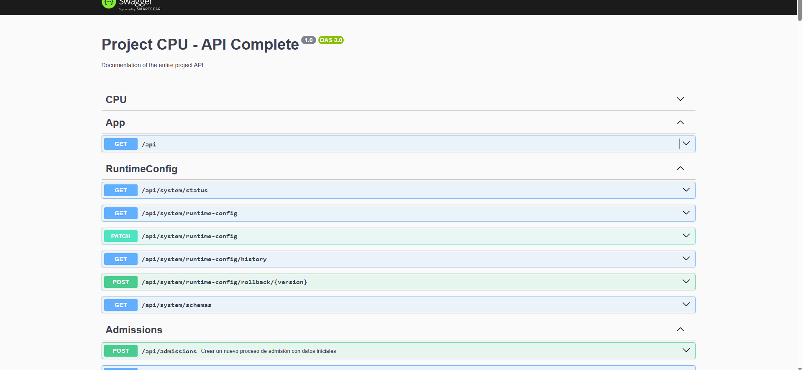

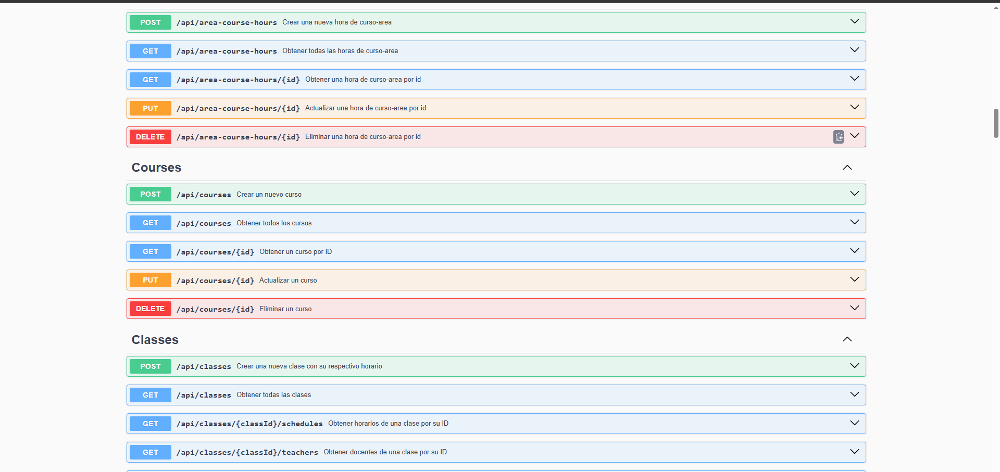

## Autenticación y autorización

La API utiliza inicio de sesión con Google. Probé `GET /api/auth/google`, que redirige al inicio de sesión, y completé el acceso desde el navegador. El callback `GET /api/auth/google/redirect` respondió `200` y permitió obtener el token de sesión.

En Postman configuré la colección con **Bearer Token** mediante `{{token}}`. Al inicio, una consulta protegida a `GET /api/system/runtime-config` devolvió `401 Unauthorized`; después de configurar la autenticación, respondió `200 OK`. Esto permitió comprobar la diferencia entre intentar acceder sin credenciales válidas y consultar con una sesión autenticada.

La autenticación identifica al usuario; la autorización determina qué operaciones puede realizar. Para las operaciones de escritura, el backend exige permisos específicos, aunque la sesión sea válida.

## GET – Configuración del sistema

**Endpoint:** `GET /api/system/runtime-config`

Consulté la configuración para comprobar el acceso autenticado, el estado de mantenimiento y el esquema activo. El resultado fue `200 OK`. Los tests verificaron la versión, la configuración de mantenimiento y que el esquema de usuarios estuviera definido; también se guardó `schema` como variable de entorno.

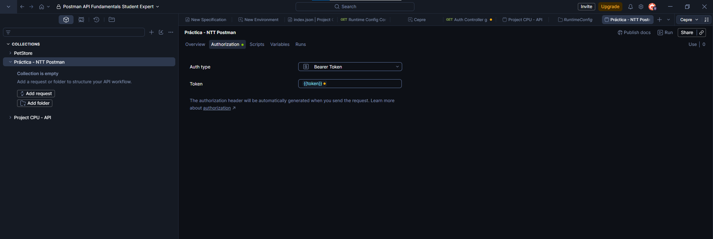

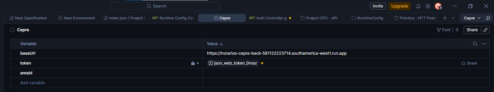

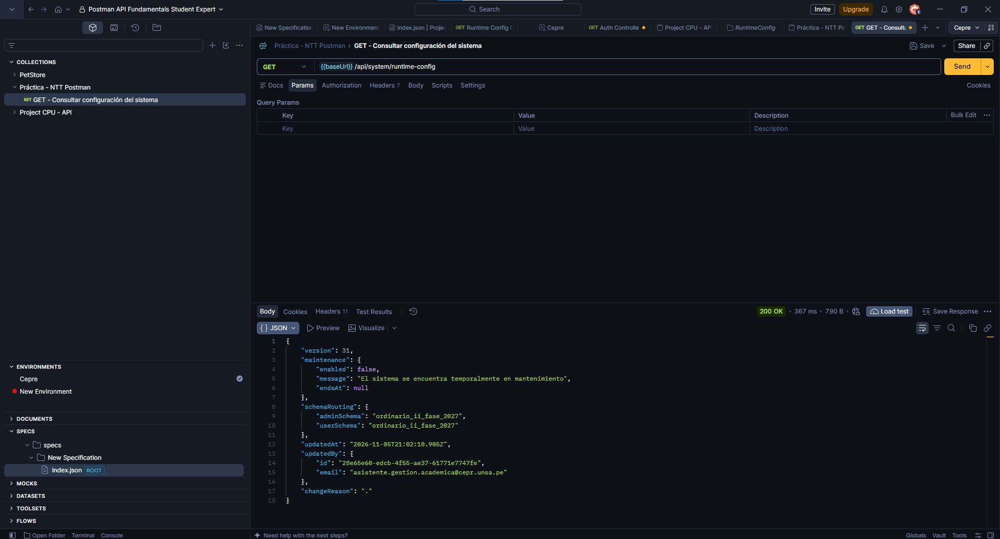

## GET – Consultar esquemas

**Endpoint:** `GET /api/system/schemas`

Consulté los esquemas disponibles y comprobé que la respuesta fuera JSON y contuviera datos. La petición respondió `200 OK`; el script guardó la respuesta en la variable `esquemas` y mostró la información en la consola.

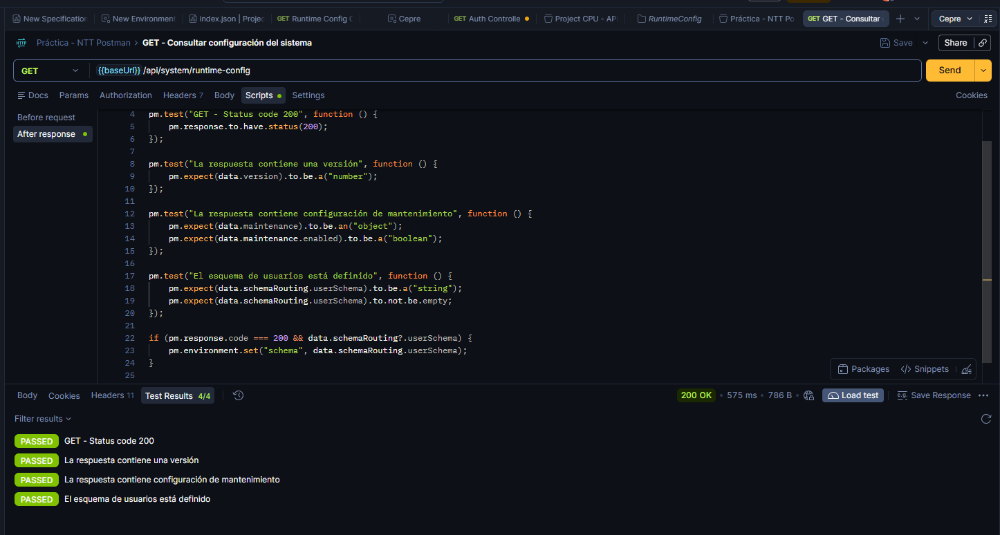

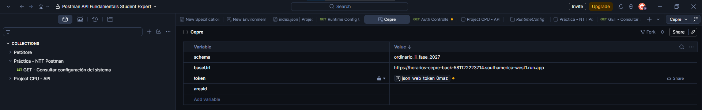

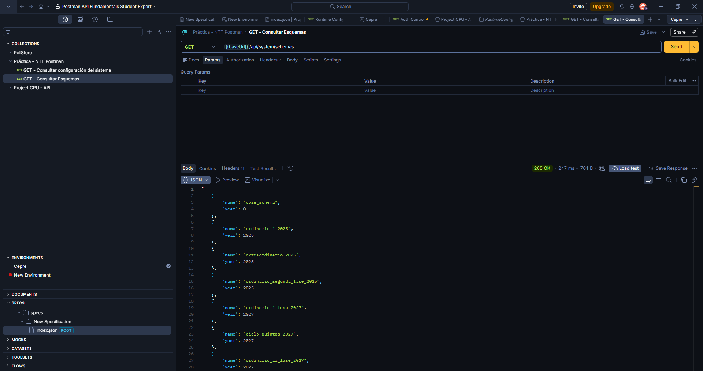

## GET – Consultar cursos

**Endpoint:** `GET /api/courses`

Probé la consulta de cursos para comprobar la lectura de información. Respondió `200 OK` y devolvió una lista de cursos. Se validó que la respuesta fuera un arreglo y se revisaron los campos `id`, `name`, `color` y `description` en las pruebas documentadas.

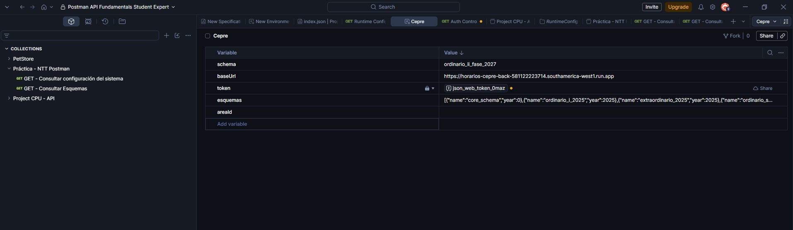

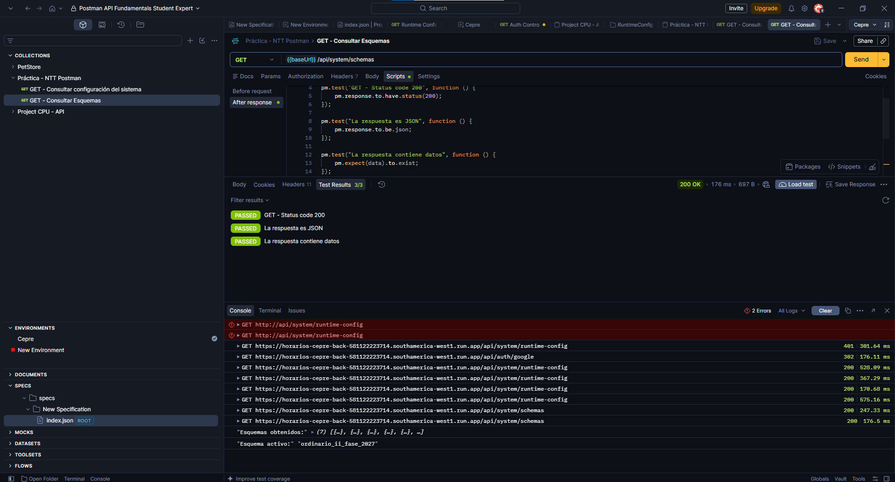

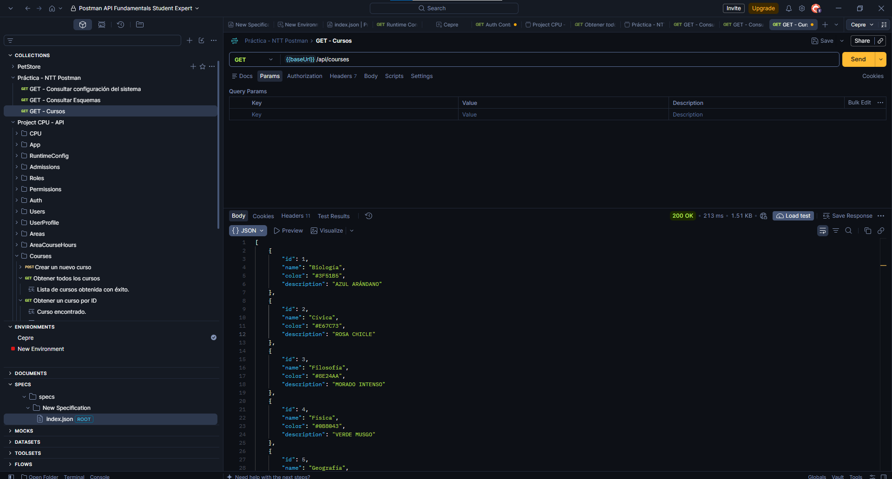

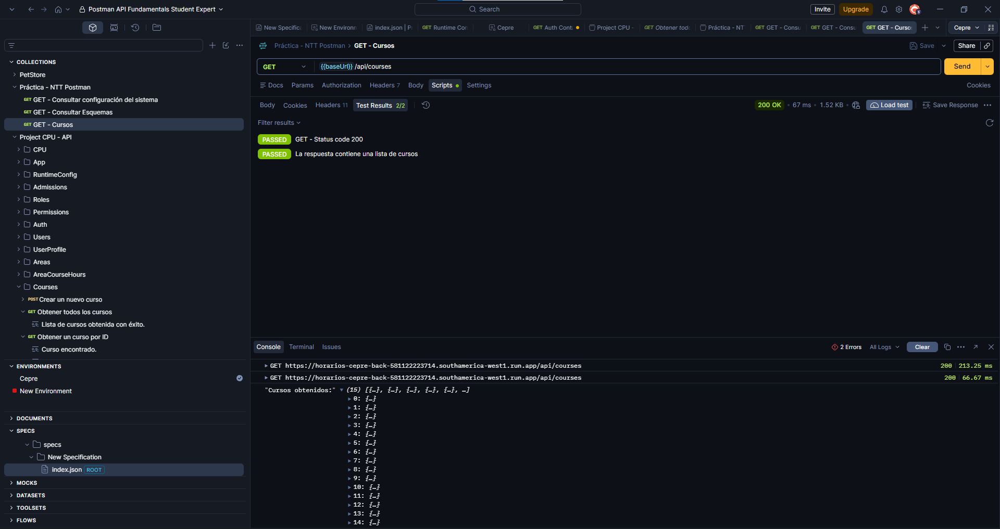

## POST – Crear curso

**Endpoint:** `POST /api/courses`

Intenté crear un curso de prueba enviando `name`, `color` y `description`. El servidor respondió `400 Bad Request` con el mensaje `Error al crear el curso`. Al revisar el código con Codex, confirmé que el ID se genera automáticamente y que el JSON enviado era válido según el DTO; sin embargo, el controlador devuelve ese mensaje genérico cuando ocurre una excepción, por lo que no se pudo determinar la causa exacta del fallo.

Los tests del POST comprobaron el código `400` y la presencia del mensaje de error. **No se creó ningún curso.**

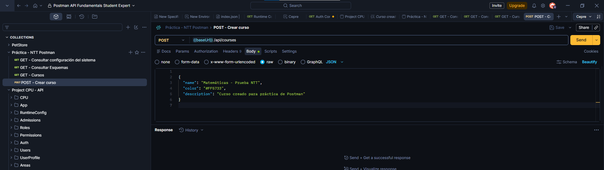

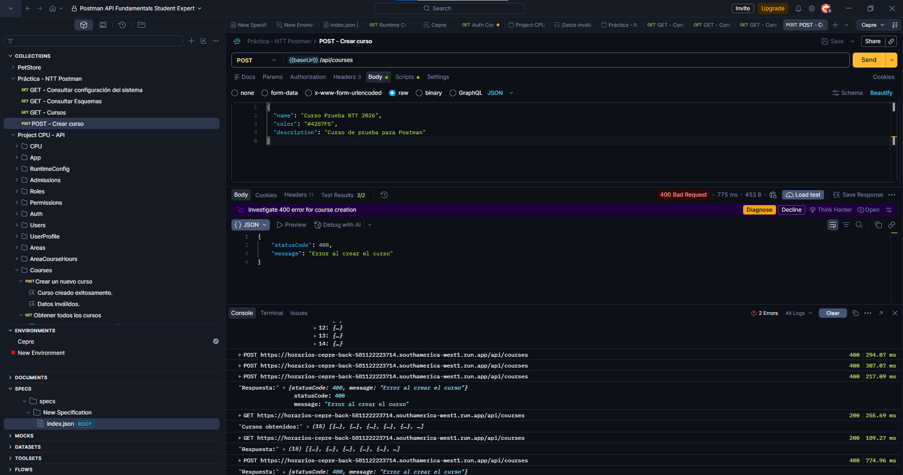

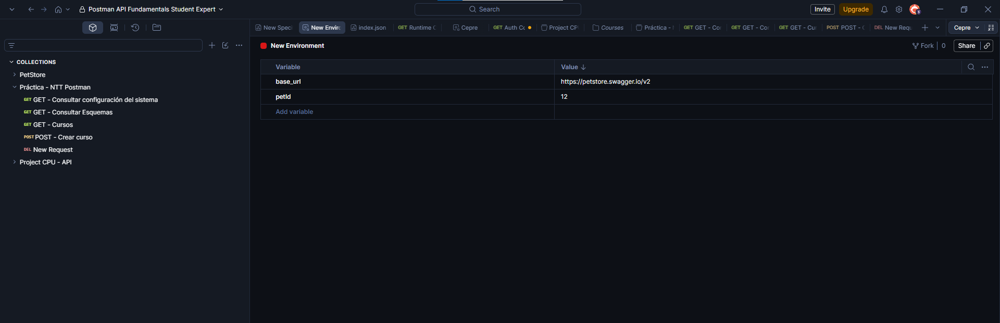

## DELETE – Eliminar curso

**Endpoint:** `DELETE /api/courses/{{cursoId}}`

Preparé la petición para eliminar el curso de prueba, pero como el POST no había creado ningún registro, la variable `cursoId` no tenía un ID válido. La respuesta fue `400 Bad Request` con el mensaje `Validation failed (numeric string is expected)`. Se registró como prueba negativa de validación, no como eliminación exitosa.

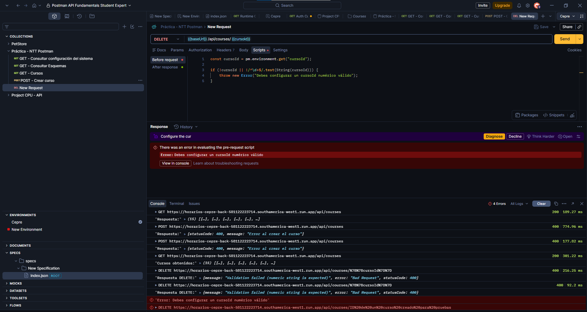

## Consideraciones y conclusión

El proyecto está desplegado en **producción** y contiene información real. Por eso no modifiqué ni eliminé cursos existentes, y no realicé inserciones exitosas. La creación de un curso de prueba falló con `400`, así que tampoco fue posible completar una prueba positiva de actualización o eliminación.

La práctica permitió verificar el acceso autenticado, observar respuestas de autorización y validación, y ejecutar consultas GET con pruebas en Postman. La colección exportada incluye las solicitudes y scripts utilizados; las capturas documentan las respuestas observadas.
