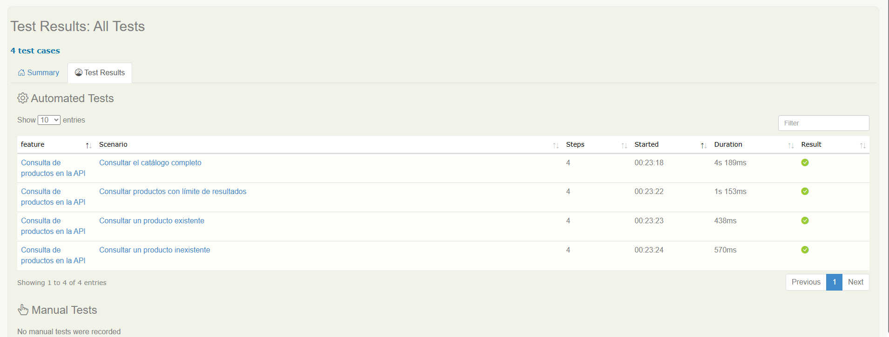
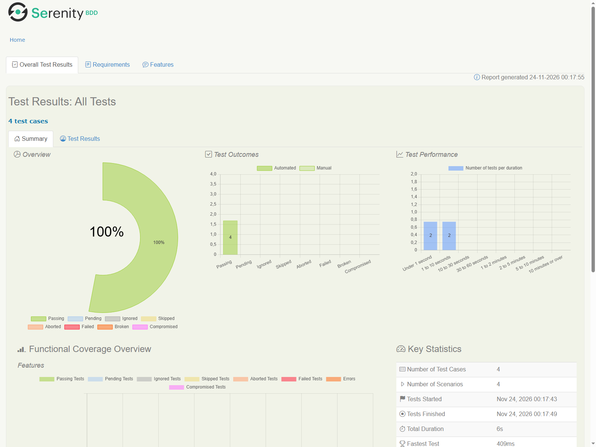
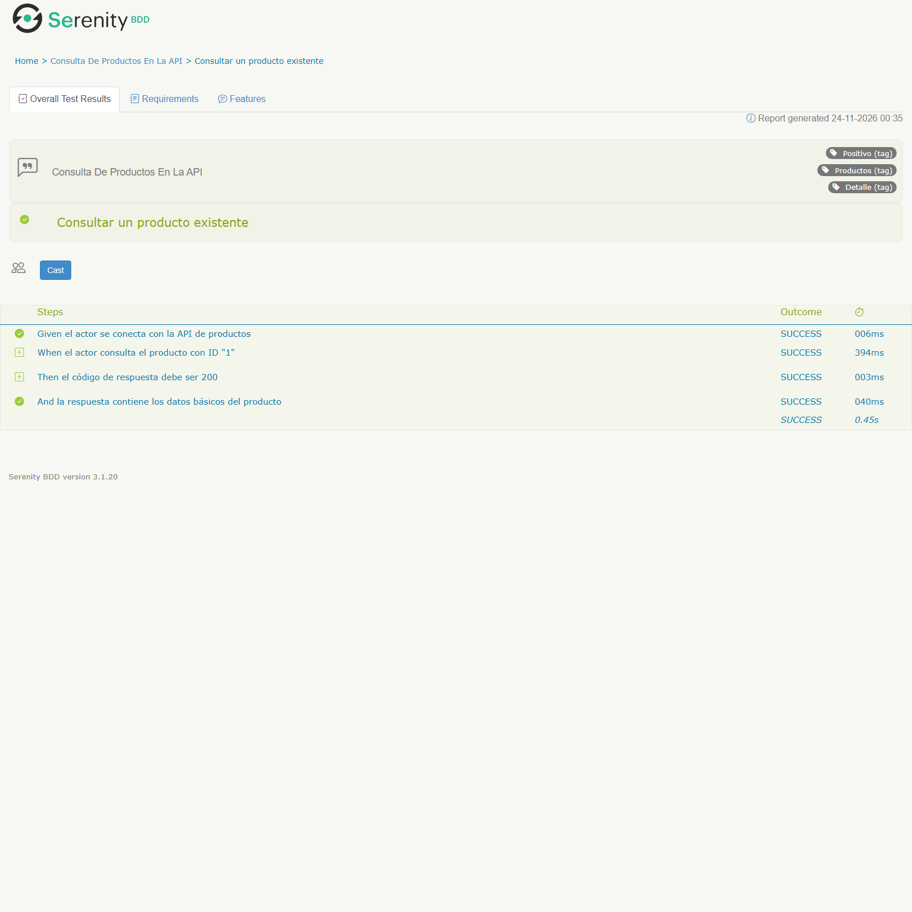

# Automatización de API de productos

Proyecto de pruebas de API con Java 17, Maven, Cucumber y Serenity Screenplay. Se valida el catálogo de práctica [DummyJSON](https://dummyjson.com/docs/products).

## Informe breve

La suite cubre dos endpoints de lectura y cuatro escenarios:

| Escenario | Tipo | Resultado esperado | Validaciones principales |
| --- | --- | --- | --- |
| Consultar el catálogo completo | Positivo | `200 OK` | Arreglo `products` presente y no vacío; total mayor que cero |
| Consultar productos con límite | Positivo | `200 OK` | Se reciben cinco productos y `limit` vale `5` |
| Consultar un producto existente | Positivo | `200 OK` | ID esperado, título no vacío y precio positivo |
| Consultar un producto inexistente | Negativo | `404 Not Found` | El servicio rechaza el ID inexistente |

**Ejecución verificada:** `mvn clean verify`, con JDK 17.0.2. Resultado: **4 escenarios aprobados, 0 fallidos y 0 con errores**. En el escenario negativo, recibir `404` es el comportamiento esperado, por eso también cuenta como prueba aprobada.

La salida HTML completa de Serenity se genera en `target/site/serenity/index.html`. La carpeta `target` se excluye de Git; las evidencias visuales se conservan en `evidencias/`.

### Resultados de Serenity



### Resumen del reporte



### Detalle de un escenario



## Decisiones de diseño

### API y alcance

Se eligió DummyJSON porque ofrece un catálogo de datos de práctica con consultas de lista, paginación y detalle. El proyecto usa dos endpoints: `GET /products` y `GET /products/{id}`. `?limit=5` es un parámetro del endpoint de catálogo, no una tercera ruta. Todas las operaciones son de lectura: la suite no crea, modifica ni elimina datos remotos.

### Cucumber y Screenplay

- **Cucumber/Gherkin** presenta los cuatro casos como criterios de aceptación legibles: tres respuestas válidas y el rechazo de un ID inexistente.
- **Step definitions** conectan cada paso Given/When/Then con las acciones y comprobaciones; no contienen la construcción directa de la solicitud HTTP.
- **Screenplay Task `GetProducts`** encapsula el verbo HTTP `GET` y recibe la ruta a consultar. Se reutiliza para la lista, la paginación y el detalle; al incorporar otro verbo en el futuro, correspondería agregar una Task para ese verbo.
- **Question `ResponseCode`** centraliza la lectura del estado HTTP, mientras los pasos `Then` validan los campos que importan para cada respuesta. Así se comprueba tanto el protocolo como los datos entregados.
- **Serenity** registra escenarios, pasos y resultados en el reporte HTML para revisar la ejecución y respaldar la demo.

Este alcance cumple el mínimo de dos endpoints, tres escenarios positivos, uno negativo y aserciones sobre contenido. También mantiene la ejecución segura frente a datos compartidos al limitarla a consultas.

## Requisitos y ejecución

- JDK 17.
- Maven 3.8 o superior.
- Acceso a internet para descargar dependencias y consultar DummyJSON.

Desde la carpeta del proyecto, ejecuta:

```sh
mvn clean verify
```

Después abre `target/site/serenity/index.html` en el navegador para revisar el resumen, los escenarios y sus solicitudes/respuestas.
