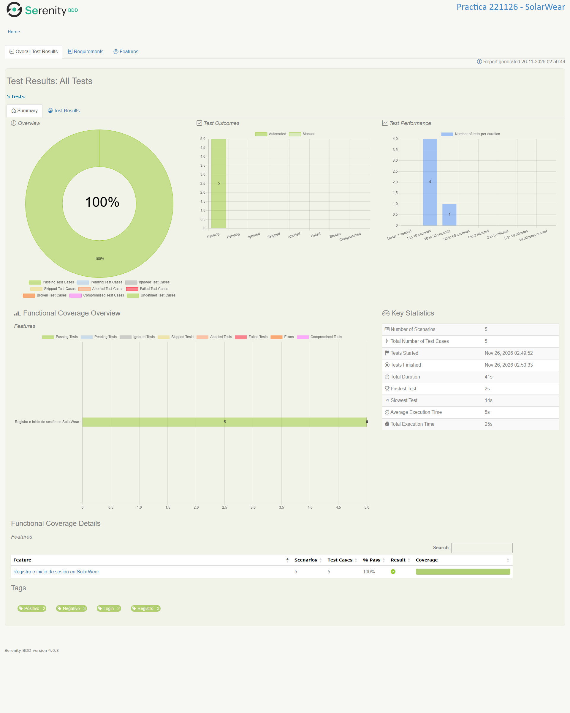
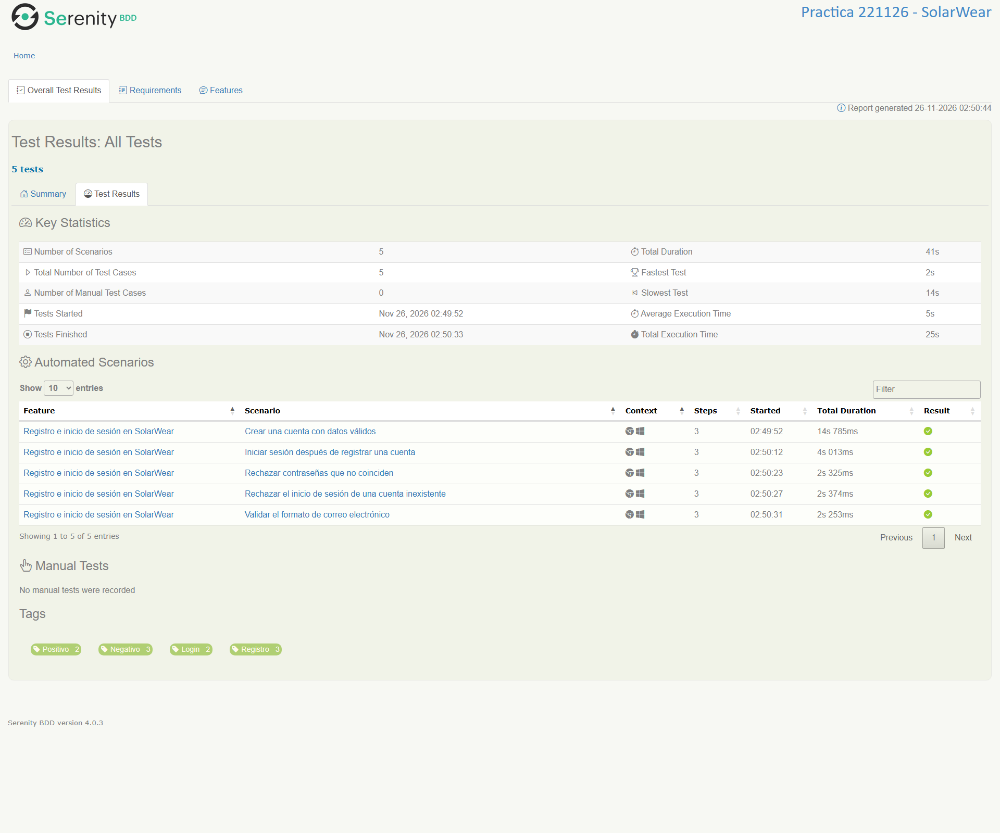
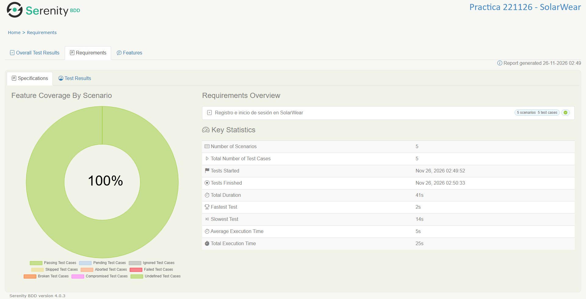
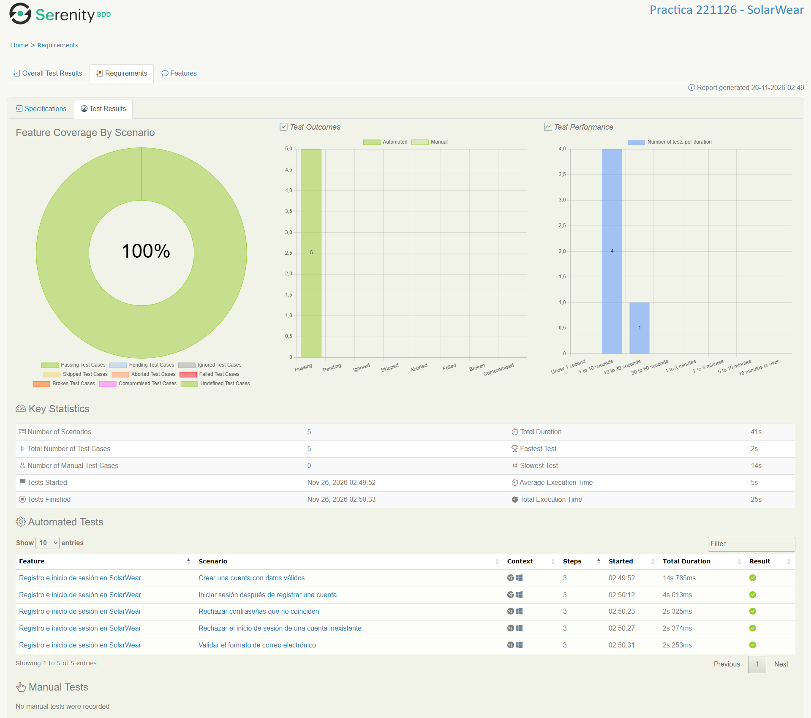
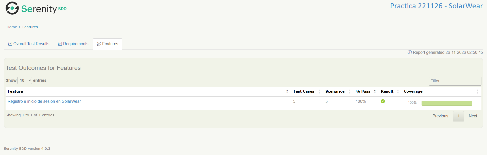
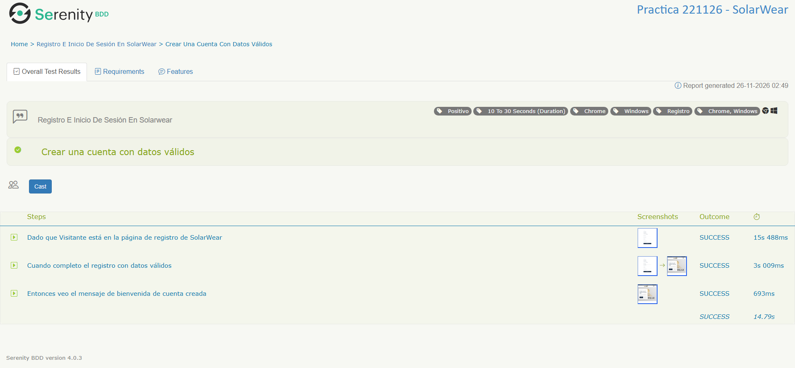

# Automatización web de SolarWear

Proyecto de pruebas web con Java 17, Maven, Cucumber, Serenity Screenplay y Selenium. La suite automatiza el registro y el inicio de sesión en [SolarWear](https://solar-wear.vercel.app/).

## Informe breve

La última ejecución reportada por Serenity contiene cinco escenarios: dos positivos y tres negativos. Los cinco aparecen aprobados, sin fallos.

| Escenario | Tipo | Validación principal |
| --- | --- | --- |
| Crear cuenta con datos válidos | Positivo | Confirmación de registro |
| Iniciar sesión después de registrar una cuenta | Positivo | Menú de cuenta autenticada |
| Rechazar contraseñas que no coinciden | Negativo | Mensaje de validación |
| Rechazar una cuenta inexistente | Negativo | Mensaje de cuenta no encontrada |
| Validar el formato del correo | Negativo | Rechazo del correo inválido |

Los flujos positivos usan los correos simples `prueba@test.com` y `prueba2@test.com`. Si la página conserva una cuenta de una ejecución anterior, usa otro correo de prueba disponible. Serenity genera el reporte en `target/site/serenity/index.html`. `target/` se excluye de Git; las capturas incluidas abajo se guardan en `evidencias/`.

## Reporte Serenity

### Overall Test Results: Summary

### Overall Test Results: Test Results

### Requirements: Specifications

### Requirements: Test Results

### Features

### Detalle de escenario

## Decisiones de diseño

- **Cucumber/Gherkin** describe los flujos en español y separa los casos positivos y negativos.
- **Page Objects** centralizan las páginas y sus localizadores para evitar repetir selectores.
- **Tasks** agrupan acciones del usuario, como abrir registro, crear una cuenta, iniciar sesión y cerrar sesión.
- **Questions** verifican los resultados observables de la interfaz, como mensajes de validación y el menú autenticado.
- **Step definitions** conectan los pasos Gherkin con actores, Tasks y Questions; las comprobaciones no quedan mezcladas con los selectores.
- **Utilidades Serenity** preparan y cierran el escenario y adjuntan capturas al reporte. Así se puede revisar el estado de la página paso a paso.

Este diseño mantiene las responsabilidades separadas y hace que los escenarios sean legibles para la demo. Las capturas adicionales de los flujos están en `evidencias/`.

